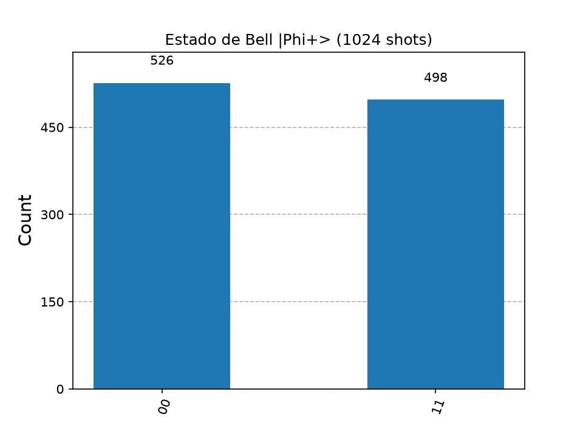
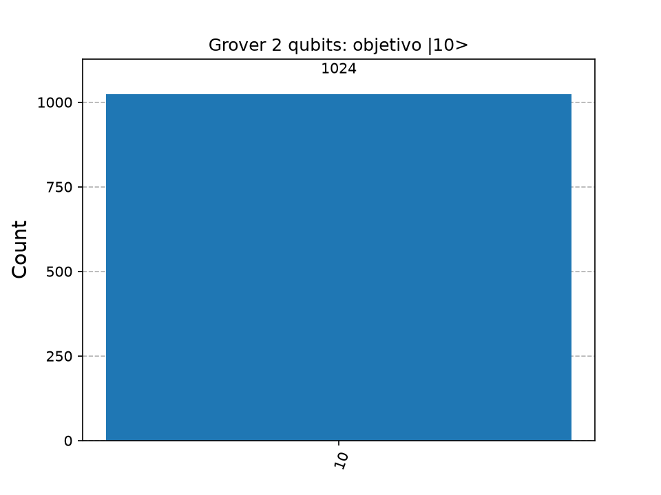
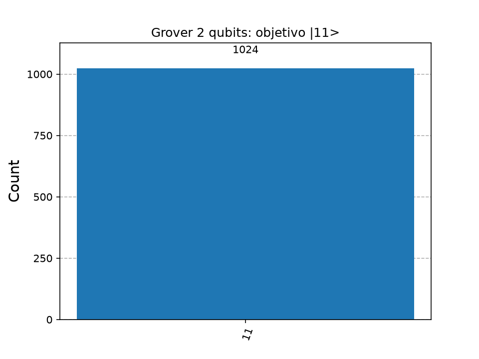
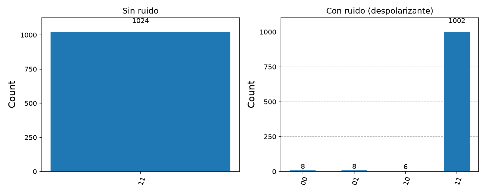
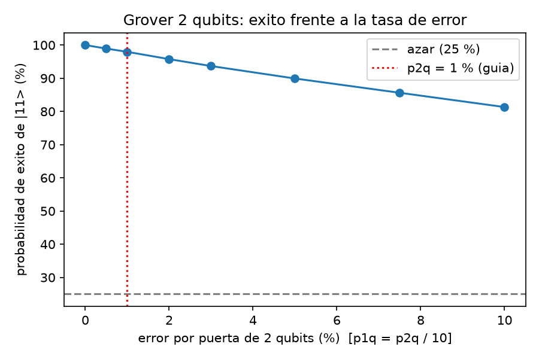
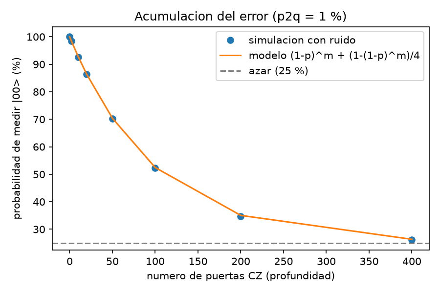
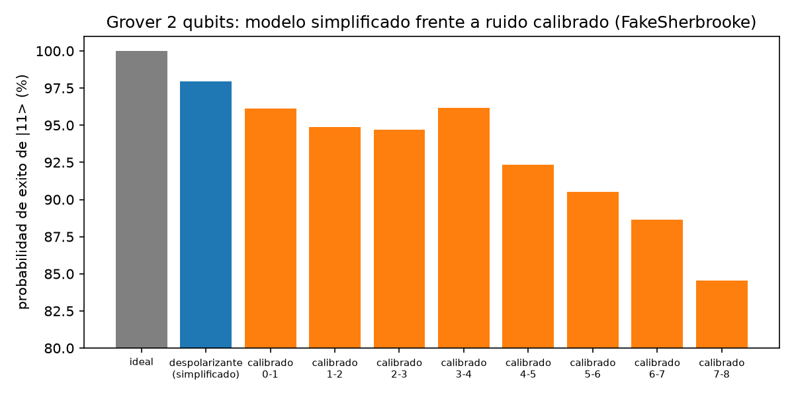

# salas-post1-u12 — Computación cuántica: laboratorio Qiskit y análisis del impacto cuántico en ciberseguridad

**Autor:** César Hernán Salas Peñaranda  
**Curso:** Arquitectura de Computadores — Unidad 12, post-contenido (laboratorio en dos partes)  
**Repositorio único:** `salas-post1-u12`

La Parte 1 implementa y simula circuitos cuánticos con Qiskit sobre el simulador clásico `AerSimulator`: el estado de Bell, el algoritmo de Deutsch-Jozsa, el algoritmo de Grover para 2 qubits y una versión de Grover bajo un modelo de ruido despolarizante. La Parte 2 es un análisis técnico del impacto de la computación cuántica en la criptografía, en [`docs/analisis-pqc.md`](docs/analisis-pqc.md).

## Estructura del repositorio

```
salas-post1-u12/
├── README.md
├── src/          # Parte 1: bell_state.py, deutsch_jozsa.py, grover.py, grover_noise.py
├── capturas/     # histogramas y comparaciones generados por los programas
└── docs/         # Parte 2: analisis-pqc.md
```

---

# Parte 1 — Laboratorio de circuitos cuánticos con Qiskit

## Entorno de trabajo

Todos los experimentos usan el simulador clásico `AerSimulator`; no se necesita hardware cuántico ni una cuenta de IBM Quantum.

| Componente | Versión |
|---|---|
| Sistema operativo | Windows 11 |
| Python | 3.12.10 (64 bits) |
| Qiskit | 1.4.6 (rama 1.x, como pide la guía) |
| Qiskit Aer | 0.18.4 |
| Matplotlib | 3.11.2 |

Se usa un entorno virtual dentro del proyecto (`.venv`, que no se versiona). Instalación y ejecución desde la raíz del repositorio:

```
python -m venv .venv
.venv\Scripts\python.exe -m pip install "qiskit>=1.0,<2" qiskit-aer matplotlib pylatexenc "qiskit-ibm-runtime<0.38"
.venv\Scripts\python.exe -c "import qiskit; print(qiskit.__version__)"
.venv\Scripts\python.exe src\bell_state.py
```

Se fijó `qiskit<2` porque la guía está escrita para la API 1.x; con `pip install qiskit` sin límite se instalaría hoy la serie 2.x. `qiskit-ibm-runtime` solo se necesita para el programa auxiliar `grover_noise_backend.py` (datos de calibración de un backend IBM guardados localmente, sin cuenta); se fija por debajo de la 0.38 porque las versiones nuevas arrastran Qiskit 2.x. Se exige Python 3.12 porque una línea de la guía (`grover.py`) anida comillas dobles dentro de un f-string, algo válido solo desde esa versión.

Los programas calculan la carpeta `capturas/` a partir de su propia ubicación, así que pueden ejecutarse desde cualquier directorio.

## Paso 1 — Estado de Bell (`src/bell_state.py`)

El estado de Bell |Φ⁺⟩ = (|00⟩ + |11⟩)/√2 es el estado entrelazado más simple. Se prepara con una puerta Hadamard en el qubit 0, que crea la superposición (|0⟩ + |1⟩)/√2, y una CNOT con el qubit 0 como control y el qubit 1 como objetivo, que correlaciona los dos qubits. El circuito es:

```
     ┌───┐     ┌─┐
q_0: ┤ H ├──■──┤M├───
     └───┘┌─┴─┐└╥┘┌─┐
q_1: ─────┤ X ├─╫─┤M├
          └───┘ ║ └╥┘
c: 2/═══════════╩══╩═
                0  1
```

El programa mide 1024 veces, comprueba con un `assert` que nunca aparecen |01⟩ ni |10⟩, y además calcula la fidelidad del vector de estado del circuito (sin medir) con el |Φ⁺⟩ teórico.

### Resultados (1024 shots)

| Estado medido | Cuentas | Porcentaje | Esperado |
|---|---|---|---|
| \|00⟩ | 526 | 51.4 % | ~50 % |
| \|11⟩ | 498 | 48.6 % | ~50 % |
| \|01⟩ | 0 | 0 % | 0 % |
| \|10⟩ | 0 | 0 % | 0 % |

Fidelidad con |Φ⁺⟩: **1.0000**.

### Interpretación cuántica

Antes de medir, los dos qubits están en una superposición de |00⟩ y |11⟩ que no se puede escribir como producto de un estado del qubit 0 por uno del qubit 1: están **entrelazados**. Al medir, cada resultado aparece con probabilidad |amplitud|² = 1/2, pero los dos qubits siempre coinciden: si el qubit 0 da 0, el qubit 1 da 0, y lo mismo con 1. Esa **correlación perfecta** es la firma del entrelazamiento; un par de qubits sin correlación daría los cuatro resultados con 25 % cada uno. La diferencia entre 526 y 498 (51.4 % y 48.6 %) es fluctuación estadística: con 1024 mediciones la desviación típica del conteo de cada estado es √(1024 · 0.5 · 0.5) = 16, y la desviación observada de 14 respecto de 512 es menos de una desviación típica.

**Checkpoint 1.** `bell_state.py` ejecuta sin errores y los conteos muestran solo |00⟩ y |11⟩ con distribución aproximada 50/50.



## Paso 2 — Algoritmo de Deutsch-Jozsa (`src/deutsch_jozsa.py`)

Deutsch-Jozsa decide si una función `f: {0,1}ⁿ → {0,1}` es **constante** (el mismo valor para todas las entradas) o **balanceada** (0 en exactamente la mitad de las entradas y 1 en la otra mitad) con una sola evaluación del oráculo. El circuito, para n = 2 qubits de entrada y un qubit auxiliar (ancilla), es:

1. Inicializar el ancilla en |−⟩ (`X` y luego `H`) y poner los n qubits de entrada en superposición uniforme (`H`).
2. Aplicar el oráculo **una sola vez**.
3. Aplicar `H` a los n qubits de entrada (interferencia) y medirlos; el ancilla no se mide.

Los oráculos de n = 2 son: el **constante** f(x) = 0 (no hace nada) y el **balanceado** f(x) = x₀ ⊕ x₁ (una CNOT de cada qubit de entrada al ancilla). Circuito completo con el oráculo balanceado:

```
     ┌───┐          ┌───┐     ┌─┐
q_0: ┤ H ├───────■──┤ H ├─────┤M├───
     ├───┤       │  └───┘┌───┐└╥┘┌─┐
q_1: ┤ H ├───────┼────■──┤ H ├─╫─┤M├
     ├───┤┌───┐┌─┴─┐┌─┴─┐└───┘ ║ └╥┘
q_2: ┤ X ├┤ H ├┤ X ├┤ X ├──────╫──╫─
     └───┘└───┘└───┘└───┘      ║  ║
c: 2/══════════════════════════╩══╩═
                               0  1
```

### Resultados (1024 shots)

| Oráculo | Conteos | Interpretación del programa |
|---|---|---|
| Constante f(x) = 0 | `{'00': 1024}` | constante |
| Balanceado f(x) = x₀ ⊕ x₁ | `{'11': 1024}` | balanceada |
| Constante f(x) = 1 (adicional) | `{'00': 1024}` | constante |
| Balanceado f(x) = x₀ (adicional) | `{'01': 1024}` | balanceada |
| Balanceado f(x) = x₁ (adicional) | `{'10': 1024}` | balanceada |

El oráculo constante produce únicamente |00⟩ y el balanceado nunca lo produce (`assert` incluidos), con una distribución totalmente determinista: 1024 de 1024. En Qiskit el bit más a la derecha de la cadena es el qubit 0, por eso f(x) = x₀ da `01` y f(x) = x₁ da `10`.

### Por qué basta una evaluación del oráculo

Con el ancilla en |−⟩, una llamada al oráculo no cambia el ancilla sino que **imprime la fase** (−1)^f(x) sobre cada estado de entrada |x⟩ (*phase kickback*). Tras la segunda ronda de Hadamard, la amplitud del estado |00⟩ es (1/2ⁿ) Σₓ (−1)^f(x): vale ±1 si f es constante (todos los términos tienen el mismo signo) y vale 0 si f es balanceada (la mitad de los términos son +1 y la otra mitad −1, y se cancelan por interferencia destructiva). Por eso medir |00⟩ con probabilidad 1 indica "constante" y cualquier otro resultado indica "balanceada", sin ambigüedad.

Un algoritmo clásico determinista necesita, en el peor caso, 2ⁿ⁻¹ + 1 evaluaciones: para n = 2 son **3**, porque dos evaluaciones iguales no bastan (una función balanceada también puede dar el mismo valor en dos entradas) y hace falta una tercera. El circuito cuántico usa **1**. La ventaja crece exponencialmente con n: para n = 30 la versión clásica necesita 2²⁹ + 1 ≈ 5.4 × 10⁸ evaluaciones y la cuántica sigue necesitando una.

**Checkpoint 2.** `deutsch_jozsa.py` ejecuta correctamente para ambos oráculos: el constante produce únicamente |00⟩ y el balanceado nunca produce |00⟩.


## Paso 3 — Algoritmo de Grover con 2 qubits (`src/grover.py`)

Grover busca el elemento marcado en una base de datos no estructurada con aceleración cuadrática. Con n = 2 qubits el espacio tiene N = 4 elementos. El circuito de una iteración es:

1. **Superposición uniforme:** `H` en los dos qubits; los cuatro estados quedan con amplitud 1/2.
2. **Oráculo de fase:** invierte el signo (fase −1) del estado marcado. Para |11⟩ basta una `CZ`; para otro objetivo se rodea la `CZ` con puertas `X` sobre los qubits cuyo bit objetivo es 0.
3. **Difusor** (inversión alrededor de la media): `H`, `X`, `CZ`, `X`, `H` en los dos qubits.

```
     ┌───┐   ┌───┐┌───┐   ┌───┐┌───┐┌─┐
q_0: ┤ H ├─■─┤ H ├┤ X ├─■─┤ X ├┤ H ├┤M├───      (objetivo |11>)
     ├───┤ │ ├───┤├───┤ │ ├───┤├───┤└╥┘┌─┐
q_1: ┤ H ├─■─┤ H ├┤ X ├─■─┤ X ├┤ H ├─╫─┤M├
     └───┘   └───┘└───┘   └───┘└───┘ ║ └╥┘
c: 2/════════════════════════════════╩══╩═
                                     0  1
```

**Corrección respecto a la guía.** El oráculo de la guía para `target="01"` aplica `X` al qubit 0 y el de `"10"` aplica `X` al qubit 1. Qiskit escribe las cadenas con el qubit 0 a la **derecha** (`"q1q0"`), de modo que esas dos ramas marcan el estado contrario. Se comprobó ejecutando el código de la guía tal como está: para `"01"` el estado más probable fue `10` (1024 de 1024) y para `"10"` fue `01`, es decir, el programa habría respondido `ERROR` en esos dos objetivos. `grover.py` calcula las puertas `X` a partir de `target[-1 - i]` (el bit del qubit i), con lo que los cuatro objetivos funcionan.

### Resultados (1024 shots, simulador ideal)

| Objetivo | Estado más probable | Cuentas del objetivo | Probabilidad | Resultado |
|---|---|---|---|---|
| \|00⟩ | \|00⟩ | 1024 | 100.0 % | CORRECTO |
| \|01⟩ | \|01⟩ | 1024 | 100.0 % | CORRECTO |
| \|10⟩ | \|10⟩ | 1024 | 100.0 % | CORRECTO |
| \|11⟩ | \|11⟩ | 1024 | 100.0 % | CORRECTO |

En los cuatro casos el estado marcado aparece con probabilidad **100 %**, por encima del 90 % que pide la guía.

### Por qué una iteración basta para n = 2

Tras la superposición uniforme, las cuatro amplitudes valen 1/2. El oráculo cambia el signo de la del estado marcado: 1/2, 1/2, 1/2 y −1/2. La media de las amplitudes es (3 · 1/2 − 1/2)/4 = 1/4, y el difusor refleja cada amplitud respecto de esa media (a → 2 · 1/4 − a): las tres no marcadas quedan en 2 · 1/4 − 1/2 = **0** y la marcada en 2 · 1/4 − (−1/2) = **1**. Toda la probabilidad se concentra en el estado objetivo tras una sola iteración.

Geométricamente, el estado inicial forma con el subespacio de los estados no marcados un ángulo θ con sen θ = 1/√N = 1/2, es decir θ = 30°; cada iteración de Grover rota el estado 2θ hacia el objetivo, así que tras k iteraciones el ángulo es (2k + 1)θ. Con k = 1 el ángulo es 3θ = 90° y la probabilidad de acertar es sen²(90°) = 1. El número óptimo de iteraciones, ≈ (π/4)√N − 1/2 = 1.07, se redondea a 1. Con N = 4 el resultado es exacto; con más iteraciones el estado "pasaría de largo" y la probabilidad bajaría.

**Checkpoint 3.** `grover.py` encuentra correctamente el estado objetivo para los cuatro objetivos con probabilidad mayor al 90 %. Los cuatro histogramas están en `capturas/`.

| \|00⟩ | \|01⟩ |
|---|---|
|  |  |
| **\|10⟩** | **\|11⟩** |
|  |  |

## Paso 4 — Grover bajo ruido simulado (`src/grover_noise.py`)

Los tres experimentos anteriores usan un simulador ideal, útil para entender la lógica de los algoritmos pero distinto de un procesador NISQ (*Noisy Intermediate-Scale Quantum*), donde cada puerta introduce un error. `qiskit_aer.noise.NoiseModel` permite inyectar ese error dentro del propio simulador. El modelo del programa añade un **error despolarizante** a cada puerta, con tasas del orden de las publicadas para procesadores superconductores:

| Puertas | Error despolarizante | Valor |
|---|---|---|
| 1 qubit (`h`, `x`) | `p1q` | 0.1 % |
| 2 qubits (`cz`) | `p2q` | 1 % |

`depolarizing_error(p, n)` sustituye el estado de los n qubits por el estado máximamente mezclado con probabilidad p. El circuito es exactamente el de Grover del Paso 3 (se importa `build_grover_circuit` de `grover.py`), con objetivo |11⟩. No se modelan errores de lectura. El simulador usa la semilla 2026 para que los números de este README sean reproducibles.

### Resultados

| Medida | Resultado |
|---|---|
| Probabilidad de éxito sin ruido | **100.0 %** (1024 de 1024) |
| Probabilidad de éxito con ruido (una corrida de 1024 shots) | **97.9 %** (1002 de 1024; los otros estados: \|00⟩ 8, \|01⟩ 8, \|10⟩ 6) |
| **Degradación** | **2.1 puntos porcentuales** |
| 30 corridas de 1024 shots con ruido | media 97.9 %, desviación típica 0.5 puntos |

**Diferencia con la guía.** La guía anticipa unos 89.4 % con ruido (una degradación de ~10.6 puntos) y dice que los valores son aproximados. Con las tasas que la propia guía configura (0.1 % y 1 %) el simulador da **97.9 %**, y la cifra se puede explicar a mano: el circuito aplica 10 puertas de 1 qubit y 2 puertas CZ. Cada evento despolarizante de 1 qubit con probabilidad 0.001 reduce el éxito en unos 0.001 × 1/2 y cada evento de 2 qubits con probabilidad 0.01 en unos 0.01 × 3/4, de modo que la pérdida esperada es de 10 × 0.0005 + 2 × 0.0075 = 2.0 puntos, la misma que se mide. Reproducir los ~10 puntos de la guía exigiría una tasa de error de 2 qubits de aproximadamente 5 % (ver el barrido).



### Barrido de la tasa de error (8192 shots, p1q = p2q / 10)

| Error por puerta de 2 qubits | Probabilidad de éxito de \|11⟩ |
|---|---|
| 0 % | 100.0 % |
| 0.5 % | 98.9 % |
| **1 % (guía)** | **98.0 %** |
| 2 % | 95.8 % |
| 3 % | 93.7 % |
| 5 % | 89.9 % |
| 7.5 % | 85.6 % |
| 10 % | 81.3 % |



### Acumulación del error con la profundidad (p2q = 1 %, 8192 shots)

Para ver cómo se acumula el error en circuitos más profundos se aplican m puertas CZ seguidas sobre |00⟩; un número par de CZ es la identidad, así que sin ruido el estado siempre vuelve a |00⟩. La probabilidad de medir |00⟩ indica cuánta señal sobrevive. El modelo `(1 − p)^m + (1 − (1 − p)^m)/4` supone que cada CZ deja el estado intacto con probabilidad 1 − p y, en caso contrario, lo mezcla por completo (queda 1/4 en |00⟩); coincide con la simulación:

| CZ seguidas | P(00) simulada | P(00) según el modelo |
|---|---|---|
| 0 | 100.0 % | 100.0 % |
| 2 | 98.4 % | 98.5 % |
| 10 | 92.6 % | 92.8 % |
| 20 | 86.3 % | 86.3 % |
| 50 | 70.3 % | 70.4 % |
| 100 | 52.3 % | 52.5 % |
| 200 | 34.7 % | 35.0 % |
| 400 | 26.1 % | 26.3 % |

La señal decae de forma exponencial con el número de puertas de 2 qubits: con 100 CZ ya solo sobrevive la mitad y con 400 el resultado es casi el azar (25 %).



**Checkpoint 4.** `grover_noise.py` ejecuta sin errores. La probabilidad de éxito sin ruido es 100 % y con ruido es 97.9 %, una degradación medible (2.1 puntos, con una desviación típica entre corridas de 0.5 puntos) y coherente con las tasas configuradas.

## Paso 5 — Decisión técnica: ¿el resultado de Grover con ruido sigue siendo útil o requiere corrección de errores?

<!-- decision-1:inicio -->
Con el ruido configurado en el Paso 4, el resultado sigue siendo útil sin corrección de errores: |11⟩ obtiene 1002 de 1024 cuentas (97.9 %) frente a 8, 8 y 6 de los otros tres estados, de modo que es con claridad el más probable. Un experimento de 1024 shots lo identifica con confianza estadística, porque el azar daría unas 256 cuentas por estado y 1002 queda a más de 50 desviaciones típicas de ese valor. El teorema del umbral de tolerancia a fallos dice que por debajo de un error físico de alrededor de 1 % por puerta se puede construir un qubit lógico arbitrariamente fiable con redundancia, y por encima agregar qubits empeora el resultado; la tasa de 2 qubits de este modelo (p2q = 1 %) está justo en ese límite. El problema aparece al escalar: el error no se degrada de forma lineal sino que se acumula de forma multiplicativa con la profundidad. En la simulación, 100 puertas CZ seguidas dejan solo un 52 % de señal y 400 la dejan en 26 %, casi el azar (25 %), y coincide con el modelo (1 − p)^m. Un Grover de 10 qubits necesita unas 25 iteraciones; si cada una se descompone en unas 30 puertas de 2 qubits (supuesto), son unas 750 puertas y la señal sobreviviente es 0.99^750 ≈ 5 × 10⁻⁴, indistinguible del ruido. Por eso los circuitos NISQ pequeños y poco profundos, como los de este laboratorio, se pueden ejecutar sobre qubits físicos sin corrección de errores, mientras que los algoritmos con utilidad práctica, como Shor para números grandes o la simulación química de moléculas complejas, requieren qubits lógicos protegidos por códigos de corrección de errores.
<!-- decision-1:fin -->

## Paso 6 — Decisión técnica: ¿qué tan representativo es el modelo de ruido despolarizante frente al hardware NISQ real?

<!-- decision-2:inicio -->
El modelo despolarizante aplica el mismo error a cualquier tipo de falla, en cualquier qubit y a cualquier puerta del mismo tamaño. El hardware superconductor real tiene tiempos de relajación T1 (decaimiento de energía) y de decoherencia T2 (pérdida de fase) distintos en cada qubit, y el error depende del tiempo que el qubit espera o ejecuta una puerta: una puerta de 2 qubits dura varias veces más que una de 1 qubit y acumula más decoherencia. Además hay un error de lectura (readout) que un error de puerta no representa. Con los datos de calibración guardados de IBM Sherbrooke (`NoiseModel.from_backend`), el éxito de Grover en pares de qubits acoplados fue de 84.6 % a 96.2 % (media 92.2 %), frente a 98.0 % del modelo simplificado: este subestima el efecto del ruido en unos 6 puntos y no distingue entre pares. El par (7, 8) tiene un error de puerta ECR de 3.78 % y el (6, 7) un T1 de 51 µs, y son los peores; el error de lectura va de 0.5 % a 4.9 %. Aun así, el modelo simplificado sigue siendo razonable para este laboratorio, cuyo objetivo es demostrar de forma controlada y reproducible que el ruido degrada la fidelidad, no predecir un dispositivo concreto; usar un modelo calibrado ataría el experimento a la disponibilidad y a una calibración que cambia. Si el objetivo fuera predecir el comportamiento del circuito en un procesador IBM específico antes de ejecutarlo en hardware, la elección correcta sería `NoiseModel.from_backend()` con la calibración más reciente de ese backend, porque el modelo simplificado sobrestima o subestima de forma sistemática mecanismos de error que no representa.
<!-- decision-2:fin -->

### Evidencia: modelo calibrado (`src/grover_noise_backend.py`)

El programa auxiliar `grover_noise_backend.py` transpila el circuito a las puertas nativas del hardware (`rz`, `sx`, `x`, `ecr`; en el par (0, 1) resultan 46 `rz`, 20 `sx`, 6 `x` y 2 `ecr`, con profundidad 48, frente a las 2 CZ del modelo simplificado) y lo simula con el ruido calibrado de `FakeSherbrooke` (8192 shots):

| Par de qubits | T1 (µs) | T2 (µs) | Error ECR | Error de lectura | Éxito de \|11⟩ |
|---|---|---|---|---|---|
| (0, 1) | 284 / 392 | 220 / 181 | 0.58 % | 0.5 % / 1.7 % | 96.1 % |
| (1, 2) | 392 / 252 | 181 / 198 | 0.47 % | 1.7 % / 2.0 % | 94.9 % |
| (2, 3) | 252 / 348 | 198 / 146 | 0.76 % | 2.0 % / 1.1 % | 94.7 % |
| (3, 4) | 348 / 410 | 146 / 369 | 0.56 % | 1.1 % / 1.1 % | 96.2 % |
| (4, 5) | 410 / 193 | 369 / 255 | 0.56 % | 1.1 % / 4.9 % | 92.3 % |
| (5, 6) | 193 / 301 | 255 / 270 | 0.36 % | 4.9 % / 3.7 % | 90.5 % |
| (6, 7) | 301 / 51 | 270 / 269 | 1.34 % | 3.7 % / 1.1 % | 88.6 % |
| (7, 8) | 51 / 349 | 269 / 242 | 3.78 % | 1.1 % / 3.9 % | 84.6 % |
| **Media** | | | | | **92.2 %** (mín. 84.6 %, máx. 96.2 %) |
| Modelo despolarizante simplificado (p1q = 0.1 %, p2q = 1 %) | | | | | 98.0 % |



**Checkpoint 5.** Las dos decisiones técnicas de la Parte 1 (Pasos 5 y 6) están incluidas arriba, cada una con más de 100 palabras. La primera evalúa que el resultado de Grover bajo ruido sigue siendo útil para 2 qubits frente al umbral de tolerancia a fallos y que el error acumulado lo destruiría al escalar. La segunda identifica las limitaciones del modelo despolarizante frente a un modelo T1/T2 calibrado sobre un backend real, con datos medidos.
