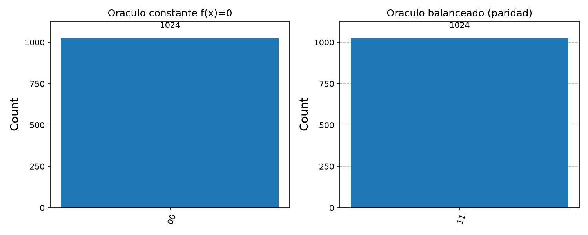

# salas-post1-u12 — Computación cuántica: laboratorio Qiskit y análisis del impacto cuántico en ciberseguridad

**Autor:** César Hernán Salas Peñaranda  
**Curso:** Arquitectura de Computadores — Unidad 12, post-contenido (laboratorio en dos partes)  
**Repositorio único:** `salas-post1-u12`

La Parte 1 implementa y simula circuitos cuánticos con Qiskit sobre el simulador clásico `AerSimulator`: el estado de Bell, el algoritmo de Deutsch-Jozsa, el algoritmo de Grover para 2 qubits y una versión de Grover bajo un modelo de ruido despolarizante. La Parte 2 es un análisis técnico del impacto de la computación cuántica en la criptografía, en [`docs/analisis-pqc.md`](docs/analisis-pqc.md).

## Estructura del repositorio

```
salas-post1-u12/
├── README.md
├── src/          # Parte 1: bell_state.py, deutsch_jozsa.py, grover.py, grover_noise.py
├── capturas/     # histogramas y comparaciones generados por los programas
└── docs/         # Parte 2: analisis-pqc.md
```

---

# Parte 1 — Laboratorio de circuitos cuánticos con Qiskit

## Entorno de trabajo

Todos los experimentos usan el simulador clásico `AerSimulator`; no se necesita hardware cuántico ni una cuenta de IBM Quantum.

| Componente | Versión |
|---|---|
| Sistema operativo | Windows 11 |
| Python | 3.12.10 (64 bits) |
| Qiskit | 1.4.6 (rama 1.x, como pide la guía) |
| Qiskit Aer | 0.18.4 |
| Matplotlib | 3.11.2 |

Se usa un entorno virtual dentro del proyecto (`.venv`, que no se versiona). Instalación y ejecución desde la raíz del repositorio:

```
python -m venv .venv
.venv\Scripts\python.exe -m pip install "qiskit>=1.0,<2" qiskit-aer matplotlib pylatexenc
.venv\Scripts\python.exe -c "import qiskit; print(qiskit.__version__)"
.venv\Scripts\python.exe src\bell_state.py
```

Se fijó `qiskit<2` porque la guía está escrita para la API 1.x; con `pip install qiskit` sin límite se instalaría hoy la serie 2.x. Se exige Python 3.12 porque una línea de la guía (`grover.py`) anida comillas dobles dentro de un f-string, algo válido solo desde esa versión.

Los programas calculan la carpeta `capturas/` a partir de su propia ubicación, así que pueden ejecutarse desde cualquier directorio.

## Paso 1 — Estado de Bell (`src/bell_state.py`)

El estado de Bell |Φ⁺⟩ = (|00⟩ + |11⟩)/√2 es el estado entrelazado más simple. Se prepara con una puerta Hadamard en el qubit 0, que crea la superposición (|0⟩ + |1⟩)/√2, y una CNOT con el qubit 0 como control y el qubit 1 como objetivo, que correlaciona los dos qubits. El circuito es:

```
     ┌───┐     ┌─┐
q_0: ┤ H ├──■──┤M├───
     └───┘┌─┴─┐└╥┘┌─┐
q_1: ─────┤ X ├─╫─┤M├
          └───┘ ║ └╥┘
c: 2/═══════════╩══╩═
                0  1
```

El programa mide 1024 veces, comprueba con un `assert` que nunca aparecen |01⟩ ni |10⟩, y además calcula la fidelidad del vector de estado del circuito (sin medir) con el |Φ⁺⟩ teórico.

### Resultados (1024 shots)

| Estado medido | Cuentas | Porcentaje | Esperado |
|---|---|---|---|
| \|00⟩ | 526 | 51.4 % | ~50 % |
| \|11⟩ | 498 | 48.6 % | ~50 % |
| \|01⟩ | 0 | 0 % | 0 % |
| \|10⟩ | 0 | 0 % | 0 % |

Fidelidad con |Φ⁺⟩: **1.0000**.

### Interpretación cuántica

Antes de medir, los dos qubits están en una superposición de |00⟩ y |11⟩ que no se puede escribir como producto de un estado del qubit 0 por uno del qubit 1: están **entrelazados**. Al medir, cada resultado aparece con probabilidad |amplitud|² = 1/2, pero los dos qubits siempre coinciden: si el qubit 0 da 0, el qubit 1 da 0, y lo mismo con 1. Esa **correlación perfecta** es la firma del entrelazamiento; un par de qubits sin correlación daría los cuatro resultados con 25 % cada uno. La diferencia entre 526 y 498 (51.4 % y 48.6 %) es fluctuación estadística: con 1024 mediciones la desviación típica del conteo de cada estado es √(1024 · 0.5 · 0.5) = 16, y la desviación observada de 14 respecto de 512 es menos de una desviación típica.

**Checkpoint 1.** `bell_state.py` ejecuta sin errores y los conteos muestran solo |00⟩ y |11⟩ con distribución aproximada 50/50.


## Paso 2 — Algoritmo de Deutsch-Jozsa (`src/deutsch_jozsa.py`)

Deutsch-Jozsa decide si una función `f: {0,1}ⁿ → {0,1}` es **constante** (el mismo valor para todas las entradas) o **balanceada** (0 en exactamente la mitad de las entradas y 1 en la otra mitad) con una sola evaluación del oráculo. El circuito, para n = 2 qubits de entrada y un qubit auxiliar (ancilla), es:

1. Inicializar el ancilla en |−⟩ (`X` y luego `H`) y poner los n qubits de entrada en superposición uniforme (`H`).
2. Aplicar el oráculo **una sola vez**.
3. Aplicar `H` a los n qubits de entrada (interferencia) y medirlos; el ancilla no se mide.

Los oráculos de n = 2 son: el **constante** f(x) = 0 (no hace nada) y el **balanceado** f(x) = x₀ ⊕ x₁ (una CNOT de cada qubit de entrada al ancilla). Circuito completo con el oráculo balanceado:

```
     ┌───┐          ┌───┐     ┌─┐
q_0: ┤ H ├───────■──┤ H ├─────┤M├───
     ├───┤       │  └───┘┌───┐└╥┘┌─┐
q_1: ┤ H ├───────┼────■──┤ H ├─╫─┤M├
     ├───┤┌───┐┌─┴─┐┌─┴─┐└───┘ ║ └╥┘
q_2: ┤ X ├┤ H ├┤ X ├┤ X ├──────╫──╫─
     └───┘└───┘└───┘└───┘      ║  ║
c: 2/══════════════════════════╩══╩═
                               0  1
```

### Resultados (1024 shots)

| Oráculo | Conteos | Interpretación del programa |
|---|---|---|
| Constante f(x) = 0 | `{'00': 1024}` | constante |
| Balanceado f(x) = x₀ ⊕ x₁ | `{'11': 1024}` | balanceada |
| Constante f(x) = 1 (adicional) | `{'00': 1024}` | constante |
| Balanceado f(x) = x₀ (adicional) | `{'01': 1024}` | balanceada |
| Balanceado f(x) = x₁ (adicional) | `{'10': 1024}` | balanceada |

El oráculo constante produce únicamente |00⟩ y el balanceado nunca lo produce (`assert` incluidos), con una distribución totalmente determinista: 1024 de 1024. En Qiskit el bit más a la derecha de la cadena es el qubit 0, por eso f(x) = x₀ da `01` y f(x) = x₁ da `10`.

### Por qué basta una evaluación del oráculo

Con el ancilla en |−⟩, una llamada al oráculo no cambia el ancilla sino que **imprime la fase** (−1)^f(x) sobre cada estado de entrada |x⟩ (*phase kickback*). Tras la segunda ronda de Hadamard, la amplitud del estado |00⟩ es (1/2ⁿ) Σₓ (−1)^f(x): vale ±1 si f es constante (todos los términos tienen el mismo signo) y vale 0 si f es balanceada (la mitad de los términos son +1 y la otra mitad −1, y se cancelan por interferencia destructiva). Por eso medir |00⟩ con probabilidad 1 indica "constante" y cualquier otro resultado indica "balanceada", sin ambigüedad.

Un algoritmo clásico determinista necesita, en el peor caso, 2ⁿ⁻¹ + 1 evaluaciones: para n = 2 son **3**, porque dos evaluaciones iguales no bastan (una función balanceada también puede dar el mismo valor en dos entradas) y hace falta una tercera. El circuito cuántico usa **1**. La ventaja crece exponencialmente con n: para n = 30 la versión clásica necesita 2²⁹ + 1 ≈ 5.4 × 10⁸ evaluaciones y la cuántica sigue necesitando una.

**Checkpoint 2.** `deutsch_jozsa.py` ejecuta correctamente para ambos oráculos: el constante produce únicamente |00⟩ y el balanceado nunca produce |00⟩.


